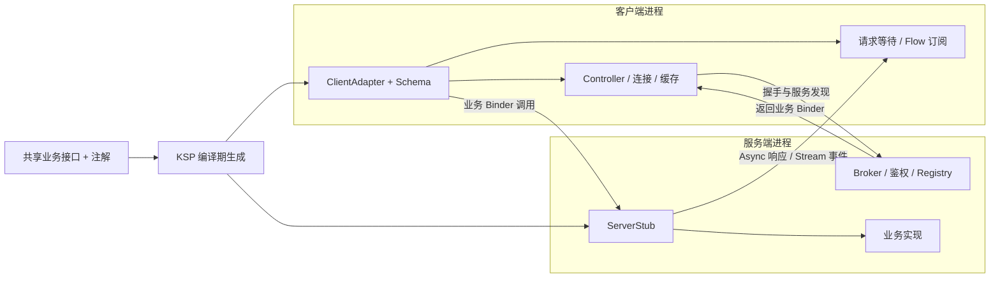
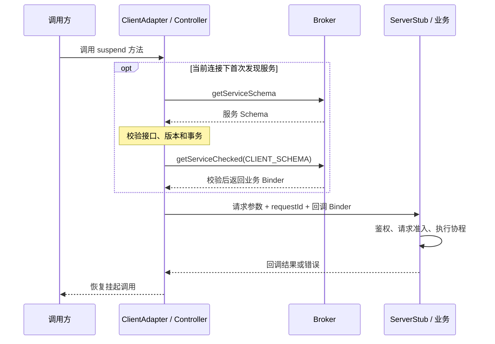

# ModernIPC

[](https://github.com/NingCui29/ModernIpc/actions/workflows/verify.yml)
[](https://github.com/NingCui29/ModernIpc/releases)

面向 Android 的 Kotlin Binder IPC 库。通过接口和注解定义跨进程服务，KSP 在编译期生成客户端代理、服务端 Stub 和协议 Schema，支持协程请求、Flow 订阅、同步调用及单向通知。

适用于同一 App 的多进程通信，以及同签名 App 之间的服务调用。仓库提供同包分进程示例、四 App 消息中枢和独立 AndLinker 对照工程。

**当前版本：`3.0.0-rc.3`（预发行）。** 七个 Maven 模块已发布，默认渠道支持匿名下载，无需 GitHub 账号或 Token。

[依赖接入](#sdk-依赖接入无需下载凭据) · [调用示例](#调用示例) · [架构与流程](#架构与调用流程) · [示例工程](#示例工程) · [完整文档](#文档)

## 功能

| 调用方式 | 接口形式 | 适用场景 |
| --- | --- | --- |
| `@IpcAsync` | `suspend fun` | 请求与响应，支持超时、取消及在途请求管理 |
| `@IpcStream` | 返回 `Flow<T>` | 持续事件订阅，区分数据、完成和错误终态 |
| `@IpcDirect` | 普通同步函数 | 后台线程中的短方法调用 |
| `@IpcOneway` | 返回 `Unit` | 不等待业务结果的单向通知 |

运行时负责 Broker 服务发现、连接重试、Binder 死亡处理及资源清理。生成代码按连接代次隔离旧响应，并在服务发现时校验接口标识、契约版本和事务签名。服务端默认进行 UID / 同签名鉴权。

## SDK 依赖接入（无需下载凭据）

### 1. 添加 Maven 仓库

在宿主工程的 `settings.gradle.kts` 中添加：

```kotlin
dependencyResolutionManagement {
    repositories {
        google()
        mavenCentral()
        exclusiveContent {
            forRepository {
                maven {
                    name = "ModernIpcPublic"
                    url = uri("https://raw.githubusercontent.com/NingCui29/ModernIpc/maven")
                }
            }
            filter { includeGroup("com.modernipc") }
        }
    }
}
```

该地址读取公开 `maven` 分支中的 Maven 制品。`exclusiveContent` 确保 `com.modernipc` 只从这里解析，避免旧 GitHub Packages 仓库返回 `401 Unauthorized`。迁移时删除原 ModernIPC 的 `maven.pkg.github.com` 仓库项；如果它还服务于其他库，可保留其他 group 的配置。

### 2. 选择契约接入方式

**快速体验仓库自带接口**，在应用模块添加：

```kotlin
dependencies {
    implementation("com.modernipc:ipc-api:3.0.0-rc.3")
}
```

`ipc-api` 包含 UserService、MessageHub 等示例契约、DTO 和已生成的双端代码，并导出所需运行时依赖。它不包含示例应用中的 Android Service 实现。

**定义自己的业务接口**，新建客户端和服务端共同依赖的 Android library 契约模块，并配置 KSP：

```kotlin
plugins {
    id("com.android.library")
    id("org.jetbrains.kotlin.android")
    id("com.google.devtools.ksp")
}

val ipcVersion = "3.0.0-rc.3"

dependencies {
    api("com.modernipc:ipc-annotations:$ipcVersion")
    api("com.modernipc:ipc-contract:$ipcVersion")
    api("com.modernipc:ipc-runtime-client:$ipcVersion")
    api("com.modernipc:ipc-runtime-server:$ipcVersion")
    api("org.jetbrains.kotlinx:kotlinx-coroutines-core:1.7.3")
    ksp("com.modernipc:ipc-compiler:$ipcVersion")
}
```

上述代码省略宿主统一管理的插件版本和 `android` 配置。生成代码的公开签名引用运行时与协程类型，因此共享契约模块使用 `api` 导出；只引入 `ipc-api` 不会为其他模块的新接口生成代码。插件配置、类型支持及服务注册见 [SDK 指南](docs/ModernIPC_SDK_Guide.md#0-依赖与生成配置)。

### 3. 环境要求

| 项目 | 当前仓库配置 |
| --- | --- |
| Android 最低版本 | API 21 |
| compileSdk / targetSdk | 34 / 34 |
| 构建 JDK | 17；JVM 字节码目标为 1.8 |
| Android Gradle Plugin | 8.2.0 |
| Kotlin / KSP | 1.9.22 / 1.9.22-1.0.17 |
| Kotlin Coroutines | 1.7.3 |

版本来源为 [Version Catalog](gradle/libs.versions.toml)。KSP 应与宿主 Kotlin 版本匹配；表中配置不表示所有插件组合及 Android 版本均已实测。

## 调用示例

下面演示 `demo-app` 中已有的 UserService，`context` 和 `scope` 由宿主组件提供。`MyBrokerService` 是示例应用源码中的服务类，已在 Manifest 声明为同 App 的独立 `:server` 进程。

```kotlin
import android.content.Intent
import com.cn.ipc.api.test.IUserServiceClientAdapter
import com.cn.ipc.client.IpcConnectionController
import com.cn.ipc.demo.MyBrokerService
import kotlinx.coroutines.launch

val controller = IpcConnectionController(
    context = context,
    targetIntent = Intent(context, MyBrokerService::class.java),
    scope = scope,
)

scope.launch {
    try {
        controller.awaitConnected()
        val users = IUserServiceClientAdapter(controller)
        println(users.getUserInfo("42"))
    } finally {
        controller.disposeAndJoin()
    }
}
```

这是一次调用后释放连接的示例。持续调用或订阅时，由宿主组件持有并复用 Controller，在组件退出时统一释放。`awaitConnected()` 会启动或加入一次连接尝试；`closeAndJoin()` 关闭后允许重连，`disposeAndJoin()` 永久释放。

完整代码：[接口定义](ipc-api/src/main/kotlin/com/cn/ipc/api/test/IUserService.kt) · [服务注册](demo-app/src/main/kotlin/com/cn/ipc/demo/MyBrokerService.kt) · [业务实现](demo-app/src/main/kotlin/com/cn/ipc/demo/UserServiceImpl.kt) · [Manifest](demo-app/src/main/AndroidManifest.xml)。自定义服务由生成的 `ServerStub` 实现业务，再通过 `RegisteredService` 注册到 Broker。

## 架构与调用流程

业务接口使用 Kotlin 注解描述；Broker 的握手和发现协议使用 AIDL。首次取得业务 Binder 后，业务调用直接进入对应 Stub。



以下为完成连接后的 Async 请求流程。冷发现按接口 Schema 校验，命中当前连接缓存后复用业务 Binder。



| 模块 | 职责 |
| --- | --- |
| `ipc-annotations` / `ipc-compiler` | 注解、编译期校验、Adapter / Stub / Schema 生成 |
| `ipc-contract` | Broker AIDL、公共协议与请求 trace |
| `ipc-runtime-client` | 连接、发现缓存、请求关联、取消和订阅管理 |
| `ipc-runtime-server` | Broker、鉴权、服务注册、请求与订阅资源管理 |
| `ipc-api` | 仓库自带契约、DTO 与生成代码 |
| `demo-client-common` | 多 App 示例共用页面与业务交互 |

更完整的状态机、终态处理和协议兼容规则见 [架构文档](docs/ModernIPC_Architecture.md)。

## 示例工程

| 工程 | 用途 |
| --- | --- |
| `demo-app` | 同 App 分进程调用、Flow、连接恢复与诊断示例 |
| `app-server` | 跨 App 消息中枢 |
| `app-client1` / `app-client2` / `app-client3` | 三个独立包、独立 UID 的客户端 |
| `benchmark-andlinker` | 独立 AndLinker 性能对照，仅用于测试 |

多 App 示例包含四类交互：

| 场景 | 业务流程 |
| --- | --- |
| 会议通知 | client1 定向发送，client2 更新会议卡并返回业务确认 |
| 仓储工单 | client1 分派，client2 接单并完成，其他客户端观察状态 |
| 配置同步 | client1 广播配置版本，client2 / client3 分别确认 |
| 遥测告警 | client2 上报温度，client3 判断阈值并广播告警 |

跨 App 接入要求匹配签名、绑定权限和包可见性配置。安装顺序、Manifest 与操作步骤见 [业务指南](docs/ModernIPC_Business_Interaction_Guide.md)。示例业务状态保存在内存中，路由回执与业务确认分别表示不同阶段，未提供持久消息队列或离线补发。

## 构建与验证

在仓库根目录使用 JDK 17、Android SDK 和 Gradle Wrapper。Windows PowerShell：

```powershell
# 全量子模块检查：含主机回归、生成代码回归与 Lint
.\gradlew.bat check

# 构建同包示例及四 App 示例
.\gradlew.bat :demo-app:assembleDebug :app-server:assembleDebug :app-client1:assembleDebug :app-client2:assembleDebug :app-client3:assembleDebug

# 发布工具与 SDK 路径探测回归
python -m unittest discover -s tests/release -v

# 从匿名 Maven 仓库实际解析并编译独立消费者
python scripts/verify_maven_consumers.py --remote-repository https://raw.githubusercontent.com/NingCui29/ModernIpc/maven --version 3.0.0-rc.3 --java-home $env:JAVA_HOME
```

Linux / macOS 将 `.\gradlew.bat` 换为 `bash ./gradlew`，Bash 中的 `$env:JAVA_HOME` 改为 `"$JAVA_HOME"`。Python 消费验证从参数、环境变量或根目录 `local.properties` 查找 Android SDK。使用 `check` 执行全量检查；根任务 `:check` 只聚合部分检查。

截至 2026-11-06，验证状态如下：

| 验证范围 | 结果与证据 |
| --- | --- |
| 当前分发配置 | master 与版本分支全量 CI 通过，30 项 Python 回归通过 |
| 匿名 Maven | 七模块复用 175 个原始文件；制品、仓库元数据与回执共 211 个文件匿名下载及哈希校验通过 |
| 独立消费者 | Gradle metadata、POM-only、Async/Flow KSP 编译及嵌套接口负例通过 |
| 历史真机回归 | 11/03 在小米 14 Ultra 上通过 86 项断言，结果绑定该次记录中的 APK |
| rc.3 Release APK | 尚未进行该发布 APK 的设备验收，不沿用历史 APK 的通过结果 |

分发与消费者证据见 [匿名发布回执](docs/releases/v3.0.0-rc.3/anonymous-publication-result.json)，设备身份与回归结果见 [验证索引](docs/benchmarks/README.md)。真机测试仅使用已确认的小米设备。

## 性能与使用边界

已有 AndLinker 对照只支持对应日期、设备、APK 和调用语义下的结论。2026-10-22 小米短 Echo 对照中，ModernIPC 完整 Async 路径仍慢于 AndLinker enqueue；请求管理优化未证明稳定 RTT 收益，专用 Async scope 的收益也取决于负载。这些数据不能作为 rc.3 发布制品的新性能成绩。方法与原始数据见 [性能报告](docs/benchmarks/Performance_Report.md)，功能和协议差异见 [两库对比](docs/ModernIPC_vs_AndLinker.md)。

- Async 默认调用预算为 30 秒，覆盖冷发现和响应等待；取消不能强制中断已开始的同步 Binder，也不能回滚远端副作用。
- Direct 适用于后台线程中的短方法；Oneway 没有业务完成回执。两者不具备完整 Async 请求的取消与在途限额语义。
- Flow 区分 NEXT / COMPLETE / ERROR；默认缓冲溢出终止流，可显式选择 CONFLATE。本地缓冲配置不等于远端背压或可靠投递。
- Schema 检查不验证 Parcelable 内部字段布局。DTO 的新旧版本兼容由业务负责；重连不会自动重放业务请求。
- 服务发现池为 4 个 worker 加 4 个排队位置，握手池为独立的最多 4 个 worker、无队列；每 Stub 默认允许 128 个 Async 在途请求。
- 自动回退到 AndLinker、Rx 适配和持久可靠消息尚未接入。

## 文档

| 阅读目标 | 文档 |
| --- | --- |
| 完成双端接入、生命周期管理与发布 | [SDK 指南](docs/ModernIPC_SDK_Guide.md) |
| 理解模块、状态机、协议与核心调用链 | [架构分析](docs/ModernIPC_Architecture.md) |
| 部署多 App 并运行业务场景 | [业务指南](docs/ModernIPC_Business_Interaction_Guide.md) |
| 比较 ModernIPC 与 AndLinker | [库对比](docs/ModernIPC_vs_AndLinker.md) |
| 查看性能结果与优化取舍 | [性能报告](docs/benchmarks/Performance_Report.md) · [优化分析](docs/ModernIPC_Optimization_Analysis.md) |
| 查看回归、多 App 验收与原始证据 | [回归报告](docs/benchmarks/Regression_Report.md) · [多 App 报告](docs/benchmarks/Multi_App_Report.md) |
| 查看源码问题与修复依据 | [工程审计](docs/ModernIPC_Engineering_Audit.md) |

## 发布

当前预发行版 [v3.0.0-rc.3](https://github.com/NingCui29/ModernIpc/releases/tag/v3.0.0-rc.3) 提供七个库、六个 Debug APK、源码、Maven 仓库及历史验证证据，共 49 个附件。使用者优先通过上方匿名 Maven 配置接入；直接下载见 GitHub Release。

`master` 保存当前源码与文档，`release/v3.0.0-rc.3` 为版本分支，`v3.0.0-rc.3` 标签固定发布源码，`maven` 分支保存公开制品。匿名渠道复用原 Release 文件，并通过校验阻止同版本内容被覆盖。GitHub Packages 作为可选认证渠道保留。

当前变更和升级说明见 [Release 说明](.github/release-notes.md)，制品身份与核验见 [发布记录](docs/releases/v3.0.0-rc.3/README.md)。历史构建、失败尝试和性能样本保留在对应报告及 `docs/benchmarks/runs/`；更早的文档原文见 [归档](docs/archive/pre-consolidation-2026-10-09.zip)。
