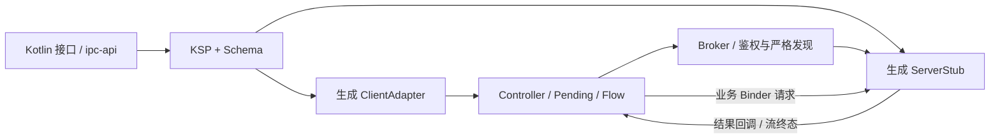

# ModernIpc

Android Binder IPC SDK 与示例工程：用 Kotlin 接口和注解描述业务，KSP 生成客户端代理、服务端 Stub 与逐事务 Schema。支持 suspend RPC、短方法同步 RPC、Flow、Oneway、Broker 服务发现、生命周期管理及重连。Broker 使用 AIDL，业务接口无需逐个编写 AIDL。

## 文档入口

| 阅读目的 | 唯一主文档 |
| --- | --- |
| 模块、连接状态、协议与核心调用链 | [架构分析](docs/ModernIPC_Architecture.md) |
| API 接入、超时、调度、Maven 发布与消费 | [SDK 指南](docs/ModernIPC_SDK_Guide.md) |
| 四 APK 部署与会议、工单、配置、遥测案例 | [业务指南](docs/ModernIPC_Business_Interaction_Guide.md) |
| 与 AndLinker 的架构、语义、性能及迁移对比 | [库对比](docs/ModernIPC_vs_AndLinker.md) |
| 优化依据、已实施改动与剩余候选 | [优化分析](docs/ModernIPC_Optimization_Analysis.md) |
| 当前验证状态与原始证据导航 | [验证索引](docs/benchmarks/README.md) |
| 接入缺陷修复、审计纠正与撤回补丁 | [工程审计](docs/ModernIPC_Engineering_Audit.md) |

测试报告按问题合并为 [性能报告](docs/benchmarks/Performance_Report.md)、[回归报告](docs/benchmarks/Regression_Report.md)、[多 App 验证报告](docs/benchmarks/Multi_App_Report.md)。日期、APK、失败运行与原始样本在各报告中保留。

## 模块与调用链

| 模块 | 职责 |
| --- | --- |
| ipc-annotations / ipc-compiler | 注解、类型检查、KSP 双端代码与 Schema 生成。 |
| ipc-contract | Broker AIDL、公共协议、默认关闭的请求 trace。 |
| ipc-runtime-client | 绑定、独立有界握手与发现、请求关联、取消和重连。 |
| ipc-runtime-server | Broker、实时鉴权、请求与订阅资源管理。 |
| ipc-api | 示例契约、DTO 和生成双端实现；当前同时依赖双端 runtime。 |
| demo-app | 同包分进程示例和受控诊断入口。 |
| demo-client-common | 跨包客户端共享页面与四个业务场景。 |
| app-server、app-client1/2/3 | 中枢与三个独立包、独立 UID 的客户端。 |
| ipc-host-tests / benchmark-andlinker | 状态机 host 门禁 / 独立 AndLinker 对照 APK，均不发布为 SDK。 |



源码入口：[模块配置](settings.gradle.kts)、[MessageHub 契约](ipc-api/src/main/kotlin/com/cn/ipc/api/hub/IMessageHubService.kt)、[Broker AIDL](ipc-contract/src/main/aidl/com/cn/ipc/IIpcBroker.aidl)。

## 构建与业务示例

使用 Android SDK、JDK 17 和仓库 Gradle Wrapper：

```powershell
.\gradlew.bat :demo-app:assembleDebug :app-server:assembleDebug :app-client1:assembleDebug :app-client2:assembleDebug :app-client3:assembleDebug
```

跨包示例要求同签名及 signature 绑定权限。安装、启动顺序、按钮操作、DEBUG 验收入口与每个场景的流程图统一见[业务指南](docs/ModernIPC_Business_Interaction_Guide.md)。测试设备限定小米 `925c23bb`。

| 场景 | 协作过程与完成含义 |
| --- | --- |
| 会议通知 | client1 定向发布 → client2 更新会议卡 → client1/3 收到同一指令确认。 |
| 仓储工单 | client1 分派 → client2 接单与手动完成 → client1/3 观察完成态。 |
| 配置同步 | client1 广播版本 → client2/3 更新演示卡 → 两个来源分别确认。 |
| 遥测告警 | client2 发送预置 25/35°C 样本 → client3 按 30°C 阈值分析 → 告警广播。 |

这些状态保存在 Activity 内存中。路由返回不代表消费；业务确认表示页面数据处理，未证明物理呈现、持久提交或硬件执行。SharedFlow 不补离线消息，重连不自动重放业务 RPC。

## 工程审计修复（2026-10-22）

已补全 `ipc-api` 和两端 runtime 的公开依赖导出，修正 SDK 契约依赖骨架。独立 Maven metadata/POM-only 消费编译与 Gradle `:check` 的 **27 项 host 检查**均通过，日常与发布 CI 已接入对应门禁。原 `0003` 取消降噪补丁已撤回，保留业务取消异常的错误终态。

新 demo APK `D0E76D89...` 仅在小米 `925c23bb` 复跑：原框架 **73 项**、独立 scope **4 项**、新增生成 Stub 业务取消/超时终态 **9 项**全通过；[设备清单](docs/benchmarks/runs/2026-10-22-xiaomi14ultra/engineering-regression2/summary.json)、[构建身份](docs/benchmarks/runs/2026-10-22-xiaomi14ultra/engineering-fixes-build/build-result.json)。首次锁屏未进入测试的失败记录也保留。该快照是随后 rc.2 发布前的功能验收，不将下节旧 APK 性能结果移用于新包；四个多 App 业务场景仍待验收。

## Async 优化与小米实测（2026-10-21/22）

发布前性能候选 `4F7ED116...` 合并客户端 pending 状态及服务端请求对象，修复旧死亡通知误取消后续请求；新增仅供 Async 的可选 `asyncCoroutineScope`，Flow 保持原 scope，SDK 默认 dispatcher 未改。小米 `925c23bb` 已通过 **73 项框架回归 + 独立 4 项 scope 检查**。

同 targetSdk 34、同 AGP 的四轮两库对照共 **64,000 次成功测量**：请求管理改动没有稳定 RTT 收益；专用 Async scope 的 16/1024 字符 P50 为 **0.770 / 0.732 ms**，AndLinker enqueue 为 **0.335 / 0.367 ms**，本轮仍未追平。专用 scope 的 P99 不稳定；另一次同 APK 16 并发短 Echo 两轮成功吞吐约增加 19%，不代表阻塞业务容量。完整统计与限制见[性能报告](docs/benchmarks/Performance_Report.md)、[回归报告](docs/benchmarks/Regression_Report.md)，配置见[SDK 指南](docs/ModernIPC_SDK_Guide.md#9-可选短任务调度配置)。

新增 `benchmark-andlinker` 仅用于测试，固定上游核心 Java，不接入 SDK 或四个业务 App。框架回归不代替四场景业务验收；新 API 不属于固定发布标签。

## 发布构建历史（2026-10-09）

当前发布目标为 **3.0.0-rc.2**，版本分支 `codex/v3.0.0-rc.2`，交付七个库与六个 Debug APK（含独立 AndLinker 对照）。构建与验证见[rc.2 发布记录](docs/releases/v3.0.0-rc.2/README.md)，内容与迁移见[本次发布说明](.github/release-notes.md)。

以下保留 **3.0.0-rc.1** 的历史构建记录，版本分支 `codex/v3.0.0-rc.1`。七个库产物与五个Debug APK统一构建 **BUILD SUCCESSFUL in 12m34s，退出码0，429任务**；Maven内部版本、APK版本与同签名校验通过。demo APK SHA-256为 `23a2802fd636f03e5821ceaf335f73907193b27560959486605e5908f7b26701`，完整身份见[发布构建记录](docs/releases/v3.0.0-rc.1/build-result.json)。

该本地包 `23A280...` 在本轮作为性能基线安装；完整框架门禁仅属于上述 `4F7ED...` 候选。四场景开发版22DAB065...的未验收记录继续保留在[多App报告](docs/benchmarks/Multi_App_Report.md)。本地发布集合包含七份publication、五APK、Maven仓库、源码、证据归档及SHA-256清单；Debug签名用于示例部署，远端发布状态需另行核实。

历史 `4494F529...` APK 的 **64 PASS / 5 DONE** 与成功请求 trace 仍保留原身份；新增握手 9 项已在本轮候选完成。各版本不混用通过数和性能数据。

## 使用边界

- Async 默认 30 秒入口预算覆盖可取消冷发现和 pending；取消等待不能中断已经开始的同步 Binder 或回滚远端副作用。
- Direct 只适合后台线程中的短方法，缺少 Async 的远端取消与在途限额。Oneway 不提供业务完成回执；Main 冷缓存需先挂起预热。
- Flow 有 NEXT / COMPLETE / ERROR；默认客户端缓冲溢出报错，可选 CONFLATE。源头丢值、离线重放与可靠投递需业务另外设计。
- 严格 Schema 按连接代次缓存并双端检查；旧 Broker 不隐式降级。Parcelable 字段布局由应用维护。
- `close` 允许重新连接，`dispose` 永久释放。握手和发现各有独立 4 worker 预算，无队列；每 Stub 默认 128 个 Async 在途许可。
- AndLinker 自动回退、Rx 适配、持久可靠消息及幂等重放尚未接入。

发布配置以[脚本](build-logic/src/main/kotlin/convention.publish.gradle.kts)为准，步骤并入[SDK 指南](docs/ModernIPC_SDK_Guide.md)。归总前 25 份项目 Markdown 的原文与 SHA-256 清单保存在[归档 ZIP](docs/archive/pre-consolidation-2026-10-09.zip)；原始运行记录留在 `docs/benchmarks/runs/`。
