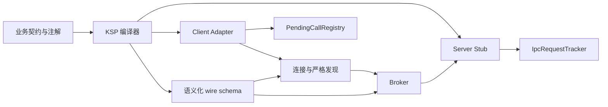
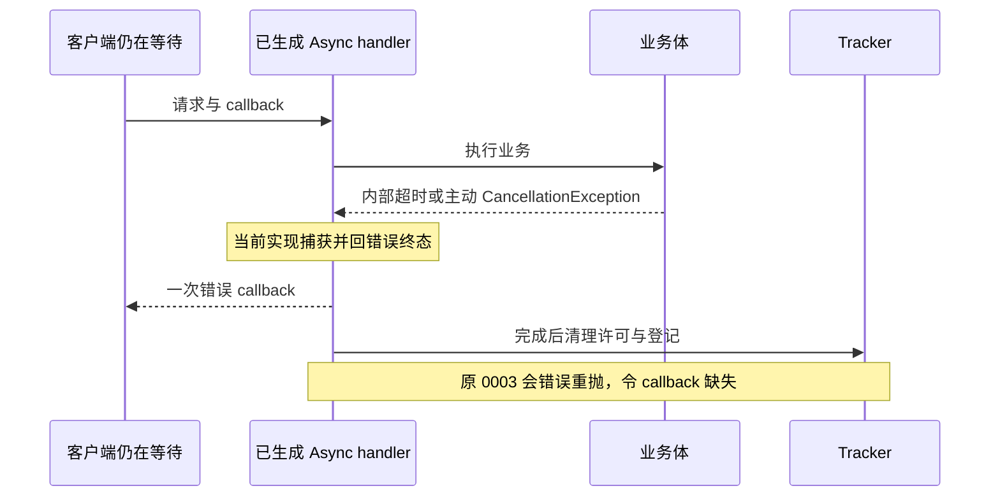

# ModernIpc 工程审计与纠正记录

> 初审与复核日期：2026-10-22。范围：SDK、示例、生成器、构建发布配置及验证材料。
> 本版将初审判断、已核实问题、撤回建议和验证边界分别记录。补丁状态见 [patches/README](../patches/README.md)；不要再次应用已落入源码的归档补丁。

## 0. 结论与证据边界

本轮已修复 **公开 ABI 的依赖导出不完整（D2/D3）**，并将已有 host 测试接入 Gradle/CI 配置（D4）。当前取消与错误终态协议继续保留，原 `0003` 降噪补丁撤回。

本地验收：独立 Maven 消费工程两种解析模式通过；根 `check` 实际 **12+15 PASS**；新 demo APK 构建 exit 0。仅在小米 `925c23bb` 上，用新 APK **`D0E76D896BDC3F0C9F01E14073F34201FFE79BFC6B07106E7885EA4181F28A9A`** 复跑原 **73+4 项**并新增生成 Stub **9 项**，全部通过。远端 CI 尚未执行，未声称这些修改已发布，也未为新 APK 重跑性能比较。证据与失败重试见第 10 节。

初审中以下判断已纠正：

| 原判断 | 复核结论 |
| --- | --- |
| Async 捕获 `CancellationException` 必然是 P0 缺陷 | 错误。已启动请求依赖生成业务体发送终态；简单重抛会丢失错误终态 |
| 原 `0001` / `0002` 能完整修复依赖接入 | 不完整。遗漏公开 ABI 中的 runtime 和协程类型 |
| AndLinker enqueue 仅测入队 | 错误。计时包含 `done.await()`，直到回调结果返回并完成内容校验 |
| `onUnbind() = true` 使纯绑定 Service 存活至进程退出 | 错误。它影响后续 `onRebind()`，不替代 started/bound 生命周期规则 |
| `minSupportedClientVersion` 比较契约版本是实现 bug | 错误。当前协议明确比较契约版本，与 App versionCode 分离 |
| 全仓零自动化、关键路径完全无覆盖 | 过度概括。已有 host 脚本、设备探针和采集脚本，缺的是日常自动门禁和部分覆盖 |
| 第五个调用一定因 4-worker 限制失败 | 不准确。同 key 冷发现共享 flight；不同工作同时占满时才可能快速拒绝 |
| docs 工作目录大小就是 Git 入库大小 | 错误。必须分开 tracked、untracked、ignored APK 与其他本地文件 |

### 0.1 历史执行与本轮执行

初审材料自述执行了客户端 host **12/12**、服务端 host **15/15**，以及一个将终态搬到 Tracker 的失败原型。它当时未完成完整 Gradle 构建，也没有连接设备。这些是初审执行边界，不能扩展成“整个项目没有构建或设备证据”。

仓库已保存不同 APK 的构建与小米验证材料：

- [10/21 构建与 host 记录](benchmarks/runs/2026-10-21-xiaomi14ultra/async-optimization-build/)。
- [10/21 功能回归清单](benchmarks/runs/2026-10-21-xiaomi14ultra/async-regression1/summary.json)：工作区候选 `4F7ED116…` 的 73 项框架探针与 4 项专用 scope 检查。
- [10/22 两库比较](benchmarks/runs/2026-10-22-xiaomi14ultra/async-compare1/comparison.json)：四轮串行 Echo，64,000 次测量成功。

本轮独立消费者、host、生成 Stub 设备探针与构建结果记录在第 10 节。历史小米通过不能自动证明随后修改的构建也通过；host doubles 不证明真实 Binder、系统 Service 生命周期或性能。

## 1. 架构与规模

SDK 分为 annotations、compiler、contract、runtime-client、runtime-server 和 api。生成器建立 Adapter、Stub 与语义化 wire schema，runtime 负责连接、发现、请求管理和服务资源清理。

初审快照统计：SDK 手写约 3.6k 行，示例约 6.0k 行；三个接口、25 个方法生成约 3,012 行 / 137.8 KB。这些数字用于说明生成代码维护成本，不能当作持续更新的当前精确统计。



值得保留的机制：

- 逐事务 schema 比较，新增事务与已有 wire 布局变更分别处理；严格路径不隐式回落旧发现。
- 同步 Binder 发现和握手移出控制锁；同 key single-flight、generation 与实例身份隔离迟到结果。
- 请求先登记后启动；取消、死亡、断连和 dispose 通过身份校验与原子移除约束清理。
- `close` 可重连，`dispose` 最终释放；请求与 Flow 资源由宿主生命周期管理。

生成 Adapter 的 trace 开/关分支产生重复代码，仍可评估辅助函数抽取。任何改动应以生成产物回归和实际性能验证为依据，不能只凭生成行数断言运行更快。

## 2. 线程、容量与预算

| 执行体 | 归属 / 上限 | 行为 |
| --- | --- | --- |
| Binder 线程池 | Android 平台 | `onTransact`、Direct、Oneway、回包等 |
| `HandshakeExecutor` | 进程级，最多 4 worker，`SynchronousQueue` | 无等待队列，满载快速拒绝 |
| `ServiceDiscoveryCache.workers` | 进程级，最多 4 worker，`SynchronousQueue` | 同 key flight 共享；不同未完成工作有界 |
| Controller `controlScope` | 每 Controller | 绑定、状态机、退避、关闭 |
| `coroutineScope` | 宿主提供 | Flow 收集与订阅 Job |
| `asyncCoroutineScope` | 宿主可选，默认回落普通 scope | Async 请求 Job |
| Async 许可 | 每 Stub 128，全 UID 共享 | `SERVER_BUSY` 快速拒绝 |

### D5：4-worker 是资源边界，不自动改成排队

已经开始的同步 Binder RPC 不能可靠中断。无界新增线程或队列可能把卡住的远端工作变成持续资源增长。4-worker + fail-fast 是有意限制，当前设备探针也覆盖饱和与恢复。

准确风险是：**四个不同、尚未结束的底层工作占满同一池时，新工作可能被拒绝**。同 key 冷发现会共享已有 flight；热缓存不提交 worker；worker 已释放时也不会因“第几个调用”而拒绝。握手拒绝可能进入连接失败/退避路径。

本轮保留此设计。若业务确需更多并发，先建立“独立 key 数、卡死 RPC 数、取消后等待者、饱和恢复”的容量测试，再决定明确上限、排队超时与隔离策略；不以“16 并发全部成功”取代失败边界设计。

### D14：重复预算仅在 Async 冷发现路径

生成的 Async Adapter 外层 `withTimeout(defaultCallTimeoutMs)` 覆盖连接、发现与请求等待；`awaitServiceBinderForConnection()` **缓存命中会在内部 timeout 前返回**，冷发现等待才进入另一层同值预算。

`callSuspendWithinDeadline()` 使用 `suspendCancellableCoroutine`，自身不新建 timeout。直接调用 `callSuspend()` 才另有自己的默认预算。故不能将它们一概写成“每次热请求创建两次同值 timeout”。外层预算从调用入口较早开始，取消具有父子传播关系；内层可以作为公开发现入口的独立保护。若消除重复预算，必须保留独立发现调用的截止语义。

其他已知限制仍成立：512 KiB 是公告而非强制校验；Binder 共享事务缓冲与负载路径需单独验证，当前没有 FD/共享内存回退。

## 3. D2 / D3：公开 ABI 的依赖导出

### 3.1 已确认问题

原 `ipc-api` 将 contract、annotations、两个 runtime 和 coroutines 全声明为 `implementation`。两个 runtime 已导出 contract，但自身公开签名使用协程类型时，coroutines 仍为 `implementation`。

公开类型包括：

| 产物 / 接口 | 消费者需要解析的类型 |
| --- | --- |
| 生成 Adapter 构造函数 | `IpcConnectionController` 等 runtime-client 类型 |
| 生成 Stub 父接口、属性与构造契约 | `IpcServiceLifecycle`、`IpcServiceSchemaProvider`、`CoroutineScope` 等 |
| 发布契约中的 Flow 方法 | `kotlinx.coroutines.flow.Flow` |
| runtime 公开 API | `CoroutineScope`、`StateFlow`、continuation 等协程类型 |

`implementation` 依赖不进入消费者 compile API variant；只在同仓示例中重复声明依赖会掩盖该问题。Maven POM 中 compile/runtime scope 和 Gradle `.module` 的 API/runtime variant 都需要核验。

### 3.2 原补丁为何不完整

- 原 `0001` 只将 contract、annotations 改为 `api`，遗漏两个 runtime 和协程。
- 原 `0002` 将 SDK 骨架的四个内部模块改为 `api`，却未补全公开 `Flow` / `CoroutineScope` 的依赖来源。
- `@IpcFacade` 的保留策略是 **SOURCE**。仅因已编译接口的源码曾使用此注解，不能断言普通消费者必须解析该注解类。导出 annotations 的接入便利性与真实二进制 ABI 要分开论证；编写新契约时仍需注解与 KSP 处理器。

本轮源码已按公开类型导出 contract、双端 runtime 与 coroutines，并保留 annotations 的便利性导出；两个 runtime 的 coroutines 也改为 api。KSP compiler 继续作为处理器依赖，不导出为消费者运行时。SDK 骨架同时补齐 coroutines 与 SOURCE 注解说明；独立消费验收结果见第 10 节。

### 3.3 验收标准

使用仓库外独立 Android 消费工程，**只声明发布到测试 Maven 仓库的 `com.modernipc:ipc-api`**，不补 runtime/contract/coroutines，不 include 本仓项目。实际编译：

- 构造或引用生成 Adapter、Stub。
- 实现带 `Flow` 的已发布契约，使用 `CoroutineScope` 与 runtime 父接口。
- 检查 POM 与 `.module` 导出，分别用默认 Gradle metadata 与 POM-only 解析编译。

此验收证明测试仓库对应产物的接入能力；不代表相同版本号的既有 GitHub 包已经替换或重新发布。

## 4. D1：终态协议与撤回的降噪补丁

### 4.1 初审、实验和两次纠正

1. 初审把 `catch (e: Exception)` 捕获取消异常视为 P0 缺陷。
2. `runningCancellationLeavesTerminalToBody` 明确要求：已启动请求由业务体负责终态，Tracker 不额外回错误。
3. 原审计试验将已启动请求的错误上报搬到 Tracker 后，`concurrent_submit_cancel_dispose_1600` 报 `Multiple terminal callbacks`。这是失败原型的历史记录，不是本轮改动或重新执行结果。
4. 复核后确认当前设计有意保留生成 handler 的错误回包；原审计将客户端主动取消后的回包开销降为 P2，并提出 `0003`。
5. 再次复核发现 `0003` 不能区分取消来源，存在丢终态风险，因此本轮**撤回整个补丁**，保持当前取消/错误 wire 协议。

### 4.2 原 `0003` 的明确反例

它用下面条件推断“客户端已经放弃请求”：

```kotlin
!_disposed.get() && asyncCoroutineScope.isActive
```

业务内超时同样满足这个条件：

```kotlin
withTimeout(100) { delay(1000) }
```

该内部超时抛出 `TimeoutCancellationException`，服务父 scope 可以仍然活跃，客户端也仍在等待。业务直接抛出 `CancellationException` 同样不是“调用方已经取消”的证明。

原 `0003` 此时重抛，Tracker 对 `started` 请求只清理、不补回错误，客户端就会等到自己的截止时间。补丁还另建关闭错误分支，却遗漏相应 `server_reply` trace。



### 4.3 当前正确边界

- 运行前被取消的请求由 Tracker 报终态；运行后的错误终态由生成业务体负责，避免双重发送。
- 客户端取消会停止本地等待并尽力发送远端取消；不能撤销已经发生的远端副作用。
- 客户端已删除 pending 时，迟到错误回包会被忽略。`server_reply` 表示服务端尝试回包，不表示客户端成功消费，也不能直接称其“与事实不符”。
- 若未来需要抑制回包，应先引入可靠的取消来源/状态协议并证明唯一终态、dispose/scope 关闭和迟到取消都保持；父 scope 活跃不是充分条件。

本轮新增 `IpcGeneratedTerminalProbe`，通过真实生成 Stub 检查 Default/专用 scope 下的业务内部超时与主动取消异常，分别观察 raw callback 和生成 Adapter，并检查默认配置恢复，共 9 项。caller 取消、dispose 与 scope 关闭继续由原框架探针登记，本轮原 73+4 项和新增 9 项已在同一新 APK、小米设备复跑通过。新增设备探针与 27 项 host 状态机检查分别计数。

## 5. D4：已有自动化与缺少的门禁

现有资产：

| 层级 | 已有载体 | 能证明什么 |
| --- | --- | --- |
| PendingCallRegistry host | `src/test/host/run.py` 与 Kotlin 用例 | 真实 registry 源码与 host doubles 的请求状态、竞态行为 |
| IpcRequestTracker host | 同上 | 许可、UID/callback 隔离、陈旧死亡通知和并发清理 |
| 设备探针 | demo 入口、ADB/Python 采集脚本 | 指定 APK、指定设备、指定场景的观察 |
| 两库性能 | 拉丁方驱动、前台门禁、CSV 与清单 | 该设备和负载下的测量，不证明通用速度排名 |
| 发布流水线 | Python 语法、部分场景源码契约、构建与产物校验 | 发布配置的一部分；原来未运行上述 host 行为测试 |

因此 D4 修订为：**host 行为测试原先未接入统一 Gradle check 与 PR/push CI 门禁**。不再称“没有任何自动化载体”。本轮新增非发布模块 `ipc-host-tests`，通过隔离的 clientHost/serverHost source set 编译原 runtime 与既有 doubles，由 JavaExec 执行原 12+15 项；根 `check` 依赖该门禁，并接入 verify/release。源码与测试没有搬迁为 JUnit。Gradle 测试编译/运行显式使用 Java 17；CI 仍需实际运行成功后才算远端门禁通过。

尚存盲区应具体描述：host Android doubles 不能覆盖系统 Binder 序列化、token/位置/缓冲限制和真实死亡通知；设备探针已有生命周期、schema、流终态、鉴权等覆盖，但覆盖范围按具体 APK/用例登记，不等于穷尽。新增生成 Stub 设备探针补上本次取消误判的内部超时与主动取消异常组合路径，本轮小米通过结果见第 10 节。

## 6. D8 / D9：版本和 Service 生命周期

### 6.1 D8 改为命名与接入说明

严格发现比较 `expected.contractVersion` 与服务 `apiVersion` / `minSupportedClientVersion`，这是当前契约版本兼容设计。升级宿主 App 的 versionCode 不自动修改契约版本；不能将此行为判成实现错位。

`minSupportedClientVersion` 名称容易使接入者误以为 App 版本，仍应在文档中写清“客户端契约版本下限”。若业务需要按安装包版本授权，应另建明确且受信的策略，不能改用 App versionCode 取代 wire schema 兼容检查。

### 6.2 D9 初审结论撤回

Android 纯绑定 Service 在最后绑定客户端离开后可销毁；`onUnbind() = true` 只是请求下次重新绑定时调用 `onRebind()`，不会独自延长 Service 到进程结束。

经 `startService` / `startForegroundService` 启动的服务还存在 started 生命周期，是否需要 `stopSelf` 要看业务所有权。无证据时不能给纯绑定基类补一个通用空闲 `stopSelf`，也不能把 Java 对象仍被引用等同于系统 Service 在线。本轮不改该生命周期行为。

## 7. 性能结果纠正

权威数字与方法见[性能报告](benchmarks/Performance_Report.md)及[10/22 comparison.json](benchmarks/runs/2026-10-22-xiaomi14ultra/async-compare1/comparison.json)。以下均为四轮各自 P50 的中位数，不是将所有原始样本合并后的 P50。

| 明确的 lane | 16 字符 ms | 1024 字符 ms |
| --- | ---: | ---: |
| baseline suspend | 0.800 | 0.867 |
| candidate Default suspend | 0.804 | 0.822 |
| candidate dedicated suspend | 0.770 | 0.732 |
| AndLinker enqueue | 0.335 | 0.367 |

**enqueue 是完整等待口径。** `benchmark-andlinker/.../MainActivity.java` 的 `measure()` 从调用前开始，`callAsync()` 发起 enqueue 后执行 `done.await(5, TimeUnit.SECONDS)`，拿到成功回调并校验 payload 后结束计时。因此不能用“只测入队”解释差距。两库的内部线程/回调模型仍不同，Async 取消、请求管理等语义也不完全相同，必须在分析中保留。

Direct 与 sync 是另一组执行模式。初审的 0.157 / 0.297 ms 拼接了不同 lane：前者来自 baseline-default，后者来自 candidate-default。修订为保留各自完整身份：

| lane / mode | 16 字符 ms | 1024 字符 ms |
| --- | ---: | ---: |
| baseline-default / direct | 0.157 | 0.320 |
| candidate-default / direct | 0.163 | 0.297 |
| candidate-dedicated / direct | 0.156 | 0.349 |
| andlinker / sync | 0.246 | 0.245 |

这批结果中 Direct 的 16 字符点估计较低，1024 字符则较高。candidate-default 的 1024 字符约比 AndLinker sync 高 21%；没有等效区间或等效检验，不能称“长负载打平”，更不能据此声称 Async 已追平。专用 Async scope 不改变 Direct 的执行协议，不能将该 lane 的 Direct 波动解释成专用 scope 对 Direct 的收益。

每轮前台资格、APK 身份、执行顺序可核验；CPU 频率、JIT/GC 与后台噪声没有全部固定。四轮样本可作探索性判断，不能把轮次波动称为“物理不合理”，也不能因四轮分布重叠就证明绝对无收益。当前证据支持：请求管理改动未证明稳定串行提速；专用 scope 作为可选配置，有限轮次有收益、串行 P99 仍波动，默认调度保留。

## 8. 其余问题登记与处理边界

下表保留原 ID。未在本轮完成专项复核的项目是后续检查项，不混为已确认缺陷或本轮已修复。

| ID | 修订分类 / 后续核验 |
| --- | --- |
| D6 | legacy `getService` 为明确兼容入口，仅 floor=1；与严格 Adapter 不回落的契约分开。是否关闭需单独兼容决策 |
| D7 | 每 service 权限/capability 字段未参与统一授权，属于明确能力边界；同签名校验与示例策略仍有效 |
| D10 | Broker 每事务创建鉴权对象可检查分配成本；不得未经基准移除事务鉴权或缓存不稳定授权结果 |
| D11 | 生成 Flow 的 `ChannelResult.isClosed` 实验 API 告警应以具体协程版本、生成物和 `-Werror` 消费者实际编译确认 |
| D12 | 示例 clientId 策略使用手工事务集合，新增业务方法需同步策略；并非 SDK 自动提供细粒度权限 |
| D13 | `callSuspendWithinDeadline` 的 serviceId/operationId 暂未参与运行逻辑；是否删除需考虑公开 API 兼容 |
| D15 | 原审计列出的 SubscriptionRegistry、IpcSubscriptionManager、BoundedDispatcher、IpcTelemetry、ModernIpcRouter、RxIpcExtensions、FlowAdapterHelper 需逐个检查引用及发布兼容后处理 |
| D16 | nonce/sessionId/maxInlinePayloadBytes/apiHash/RpcError 等字段的未使用状态要按协议方向说明；不随意移除 wire/API 字段 |
| D17 | POM 描述、license/scm 与制品签名是发布治理后续项。Debug APK 已有调试签名，与 Maven 制品签名分开 |
| D18 | Gradle 属性可提供凭据是配置入口，不证明跟踪文件中有 secret；凭据仍应来自环境或用户级属性，不写入仓库 |
| D19 | VERSION_CODE 当前为 30001；同 versionName 自动递增不宜暗改。未来安装更新按发布策略显式推进 |
| D20 | 测试契约进入 ipc-api 发布 API，需决定稳定性和后续拆分，不能无迁移直接删除 |
| D21 | 冻结 LegacyPendingCallRegistry 是基线证据，不因重复而删除或用于生产路径 |
| D22 | 工作目录体积、Git 追踪文件和 ignored APK 分开统计，见下节；原证据保留 |
| D23 | Hub `tryEmit` + DROP_OLDEST 的“delivered to all”提示可能过强，需按接收保证单独复核 |
| D24 | Activity/单例所有权、注销与销毁引用需专项生命周期检查，不由 onUnbind 返回值代替 |
| D25 | benchmark-andlinker 是隔离的同负载比较工程，已 include 但尚未提交是工作区状态；不因 untracked 直接删除 |

## 9. 仓库与构建可复现性

### 9.1 D22：区分磁盘文件和 Git 证据

2026-10-22 本轮首次复核时的工作区快照（本次新增构建/回归归档写入之前），以实际文件字节统计：

| 范围 | 文件数 | 字节 | 说明 |
| --- | ---: | ---: | --- |
| Git 索引中的 docs 文件 | 1,148 | 181,835,993 | 其中 APK 0 个；是工作树文件大小，不是 Git 压缩仓库大小 |
| docs 工作目录全部文件 | 1,753 | 516,489,706 | 包含 ignored 与 untracked，本地后续写入会变化 |
| ignored docs 文件 | 66 | 304,597,685 | 其中 52 个 APK 共 301,070,689 字节 |
| untracked、非 ignored docs 文件 | 539 | 30,056,028 | 本轮候选与实测新增材料，状态随提交变化 |

这说明“docs 约 492 MiB”不能写成“492 MiB 已入库”。本轮不删除原始 benchmark、Perfetto、冻结源码或失败构建日志；如果迁移大型证据，先建立可取回的归档、逐文件哈希和稳定索引，再评估 Git 历史治理。不能把“仓库 <50 MB”当作删除证据的硬验收指标。

非 UTF-8 崩溃日志可保留原字节、摘要与哈希。`EXCEPTION_ACCESS_VIOLATION` 落在 JIT 编译过程说明进程原生崩溃位置，不足以单凭栈断言已定位某个 JDK 缺陷；本轮不为清理文本扫描删除失败证据。

### 9.2 工具链与发布

本轮为 Gradle wrapper 增加官方 Gradle 8.5 binary distribution 的 SHA-256：`9d926787066a081739e8200858338b4a69e837c3a821a33aca9db09dd4a41026`，并为 host 模块固定 Java 17 toolchain。CI 明确 JDK 17；运行 Gradle 自身仍需显式选用支持的 JDK，没有更改系统全局 JAVA_HOME。Gradle/AGP/Kotlin/KSP 配对、依赖锁和其他模块工具链仍需按实际支持矩阵治理。不能把初审沙箱拒写 `~/.gradle` 等同于项目无法构建，也不能只凭启动日志认为构建已成功。

发布验收分别检查 Git commit/branch/tag、构建退出码、Maven metadata、Release 文件与 Packages 远端可下载性；本轮源码修复不擅自替换既有版本制品或触发发布。

## 10. 本轮修复验收

本节只登记这次“依据建议完善纠正修复”的新执行结果。构建与测试结束前不以历史通过替代。

Maven/host 的[验证结果](benchmarks/runs/2026-10-22-xiaomi14ultra/engineering-fixes-build/maven-consumers/verification.json)与[逐文件哈希归档](benchmarks/runs/2026-10-22-xiaomi14ultra/engineering-fixes-build/maven-consumers/archive.json)保留正常发布、两种解析的 compile graph、原始日志和失败重试。独立工程包含 api-only 消费与自定义 Async/Flow 契约 KSP 生成、再由仅依赖该契约的下游消费；两种解析均通过。旧本地 `3.0.0-rc.1` 元数据只读负对照被检测为缺少 compile 导出，没有覆盖旧制品。

本轮消费者/host 执行为 Windows + JDK 17；Linux 只静态检查了 wrapper 命令分支，GitHub CI **NOT_RUN**。

新 APK [构建身份](benchmarks/runs/2026-10-22-xiaomi14ultra/engineering-fixes-build/build-result.json)包含 174 份源码/配置哈希、构建退出码与 APK SHA。设备只使用 Xiaomi `925c23bb` / `24031PN0DC`，复跑前后拉包均为 `D0E76D896BDC3F0C9F01E14073F34201FFE79BFC6B07106E7885EA4181F28A9A`。

[第一次设备尝试](benchmarks/runs/2026-10-22-xiaomi14ultra/engineering-regression1/summary.json)在锁屏/Dozing 状态下未通过前台门禁，业务 `started=false`、PASS 0，保留为失败尝试，不计成业务断言失败或通过。重新连接并解锁后，[同 APK 复跑](benchmarks/runs/2026-10-22-xiaomi14ultra/engineering-regression2/summary.json) `valid=true`、脚本 exit 0。原 73 项框架回归、独立 4 项 Async scope、新增生成 Stub 9 项分别通过；同 UID 鉴权微测 4 TIME / 4 ALLOC / 1 DONE 独立记录，不算跨 UID 攻击验证。

| 项 | 验收要求 | 本轮结果 |
| --- | --- | --- |
| 完整 ABI 导出 | api/runtime 公开依赖与 POM/.module 一致 | 源码导出已修复；隔离版本 `3.0.0-consumer-check-20261022022757175411` 的六 SDK 发布含 javadoc，exit 0 |
| 独立 Maven 消费者 | api-only；自定义 Async/Flow KSP 契约与下游；metadata 与 POM-only | 两种解析的两个消费工程与 KSP 均实际通过，脚本 exit 0；使用隔离新版本，不替换旧 RC1 |
| host 门禁 | 现有客户端 12、服务端 15 进入 Gradle check / CI | 本地根 `check` 实际 12+15 PASS、exit 0；首轮 PowerShell 参数拆分失败保留，远端 CI 未声称已执行 |
| demo APK 构建 | 正常生成器与新增设备探针编译 | [构建日志](benchmarks/runs/2026-10-22-xiaomi14ultra/engineering-fixes-build/demo-build.txt)：BUILD SUCCESSFUL，2m45s，125 tasks，exit 0 |
| 真实生成 Stub 新回归 | Default/专用 scope × 内部 timeout/主动 CE × raw/Adapter，另默认恢复，共 9 项 | 新 APK、小米设备 **9 PASS / 1 DONE**；raw 路径观察一次终态，Adapter 收到远端错误且 pending/request/订阅归零 |
| 原框架取消/终态/关闭回归 | caller 取消、dispose、scope 关闭等原 73+4 项 | 同 APK **73 PASS / 6 DONE**，独立 scope **4 PASS / 1 DONE**；前台资格有效 |
| 补丁状态 | 0001/0002 记录完整已实现修复，0003 不再可应用 | 0001/0002 反向文本检查 exit 0；未执行应用/反向应用 |
| 新设备结果 | 只接受明确 APK/小米身份的新执行材料 | 仅 `925c23bb` 小米；首次前台门禁失败保留，同 APK 解锁后复跑通过；未复跑两库性能 |

## 11. 完成状态与后续顺序

本轮公开 ABI 导出、独立消费者编译、文档骨架和 host 门禁接入已完成，本地与小米验收结果见第 10 节。

1. 持续执行现有 Gradle/消费者门禁；生成 Stub 设备回归按具体 APK 和小米身份登记。
2. 对第 8 节其余登记项逐个建立最小复现和兼容边界，再确定修复范围。
3. 后续发布前实际执行远端 CI，并分别核验 Git 标签、Maven Packages 与 Release 产物；当前 CI 配置不代替远端成功记录。
4. 继续保持取消、唯一终态、鉴权、4-worker 上限与历史证据；原 `0003` 保持撤回。

本轮纠正的核心是：**以公开类型和执行证据确认修复，以真实生成 handler 与 Tracker 的组合验证终态。** 初审建议本身也应接受相同验证，不把可应用的文本 diff 当成正确性证明。
